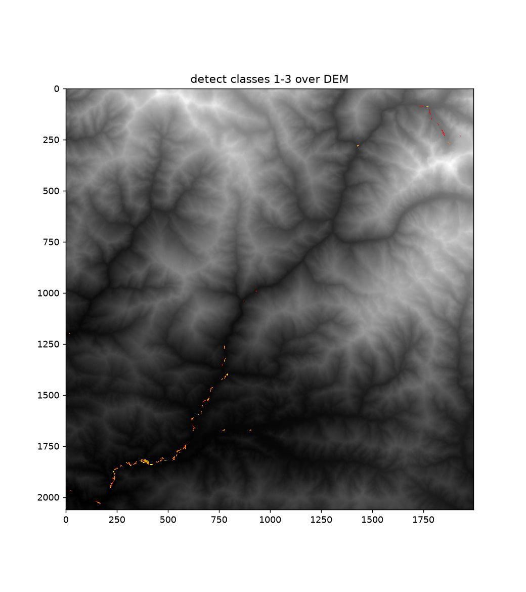
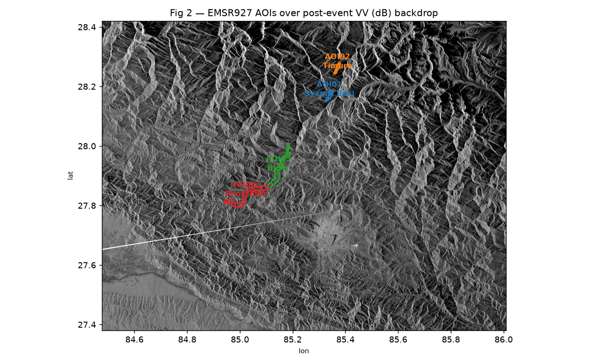
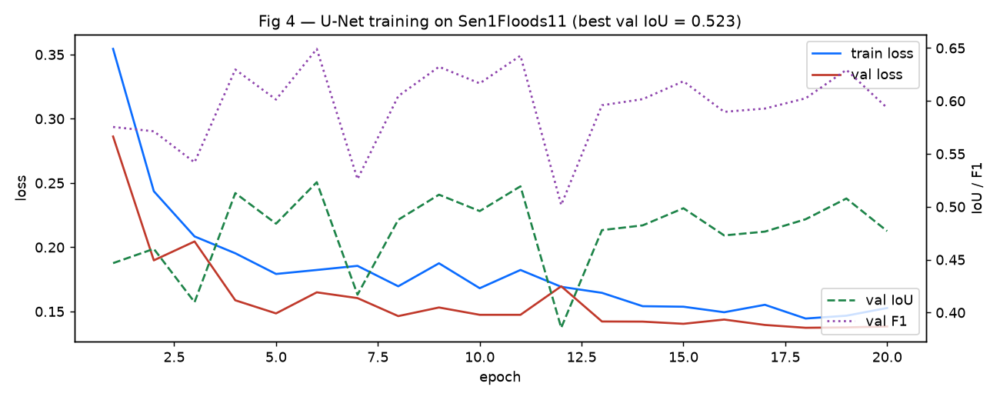
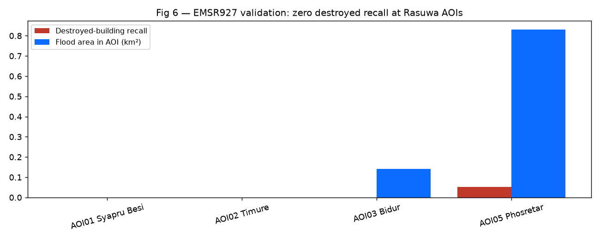

# Trishuli Flood Damage Mapping — Final Report

**Track B — Multimodal AI Hackathon 2026**

> Numbers in §4 reflect the rebuilt pipeline (ohsome pre-event OSM, bbox tightened to the Rasuwa corridor, Step 4 multi-temporal detector) and are unvalidated.

Post-event damage assessment for the **26 August 2026 Trishuli–Bhote Koshi
flash flood, Rasuwa District, Nepal**.

---

## Executive summary

We built a complete, reproducible pipeline to map flood extent, building
damage, and hospital access for the 26 August 2026 GLOF that struck the
Trishuli / Bhote Koshi corridor. The pipeline ingests free Sentinel-1 SAR,
DEM, OpenStreetMap, and Copernicus EMS Rapid Mapping reference data and
produces flood masks, affected-infrastructure layers, hospital-reachability
metrics, and a trained U-Net segmentation model.

**Status of the findings.** An earlier run on a larger study area found no detectable GLOF signal in the Sentinel-1 pair. The pipeline was then rebuilt (ohsome pre-event OSM, bbox tightened to the Rasuwa corridor, corrected reachability analysis), and in Step 4 the flood detector was replaced by a multi-temporal change detector whose threshold comes from null runs on pre-event reference scenes. On a 199.9 km² valley-floor domain it maps 0.31 km² of flood water, 2.29 km² of dark surface change and 0.54 km² of bright surface change. The flood-water class does not coincide with EMSR927 damage points. The surface-change classes lie largely on mapped landslide polygons at Bidur and Phosretar, and nothing is detected at the two Rasuwa AOIs (Syapru Besi, Timure). The output is a change-detection product, not a validated flood extent, and should not be read as the extent of the event.

**Headline numbers:**

| Metric                                            | Value                                               | Interpretation                                                                                                                                                     |
| ------------------------------------------------- | --------------------------------------------------- | ------------------------------------------------------------------------------------------------------------------------------------------------------------------ |
| Sentinel-1 VV change, river corridor (median)     | **+0.02 dB**                                        | median unchanged; a GLOF over water would shift it to −5 to −10 dB (§4.1)                                                                                          |
| U-Net flagged fraction of corridor, post / pre    | **5.03% / 5.05%**                                   | cannot discriminate the two scenes (§4.2)                                                                                                                          |
| U-Net val IoU (Sen1Floods11)                      | 0.523                                               | best epoch chosen on val; pooled held-out 0.574                                                                                                                    |
| U-Net proxy-Himalaya IoU                          | 0.554                                               | monsoon-subcontinent chips                                                                                                                                         |
| Detector threshold and gate                       | **t_hi 4.0**                                        | smallest null-run value with worst false-alarm fraction ≤ 1e-3; event seed fraction 1.09e-2 against a gate of 1.05e-3; a pre-event scene reports no change (§4.1d) |
| Detected change, valley floor (199.9 km²)         | **0.31 km² flood water**; 2.29 dark, 0.54 bright    | surface-change classes are descriptive, not confirmed damage (§4.1d)                                                                                               |
| EMSR927 damage points within 100 m of a detection | Bidur 52%, Phosretar 24%, Timure 2%, Syapru Besi 0% | flood-water class alone: recall prints 0.000 in all four AOIs (§4.4)                                                                                               |
| Our "flooded" buildings                           | **3** (+473 in surface-change classes)              | counts not comparable to EMSR927 (different areas, §4.5)                                                                                                           |

---

## 1. Study area and event

On **26 August 2026**, a flash flood reportedly triggered by a Glacial Lake
Outburst Flood (GLOF) struck Rasuwa District, Nepal. The Bhote Koshi and
Trishuli rivers, which drain south from the Nepal–China border through
Rasuwa, Nuwakot, and Chitwan, carried a debris-laden surge downstream.
Copernicus EMS Rapid Mapping was activated (**EMSR927**) and mapped
building damage across four Areas of Interest:

| AOI | Locality    | District       | Lat / Lon        | Damage points |
| --- | ----------- | -------------- | ---------------- | ------------- |
| 01  | Syapru Besi | Rasuwa         | 28.17 N, 85.34 E | 433           |
| 02  | Timure      | Rasuwa         | 28.26 N, 85.37 E | 431           |
| 03  | Bidur       | Nuwakot        | 27.93 N, 85.15 E | 2,343         |
| 05  | Phosretar   | (Chitwan edge) | 27.83 N, 85.02 E | 609           |

Total EMSR927 damage points: **3,816** (2,813 Destroyed, 354 Damaged, 649
Possibly damaged).

**Study area bbox:** `(84.95, 27.80, 85.55, 28.35)` — the Rasuwa corridor of the Trishuli valley, projected to **EPSG:32645** at **30 m**.

---

## 2. Data

| Source             | Purpose                                | Snapshot                                                                             |
| ------------------ | -------------------------------------- | ------------------------------------------------------------------------------------ |
| Sentinel-1 GRD     | SAR change detection                   | references 2026-07-11, 07-23, 08-04 and 08-16; post 2026-08-28                       |
| Copernicus DEM     | HAND and radar-geometry mask           | n/a                                                                                  |
| OpenStreetMap      | Infrastructure, settlements, hospitals | ohsome API snapshot 2026-07-27 (pre-event); manifest in `data/raw/osm/manifest.json` |
| Sen1Floods11 v1.1  | U-Net training                         | published dataset                                                                    |
| Copernicus EMSR927 | Validation reference                   | activation 2026-08-26                                                                |

**Sentinel-1 scenes.** Two products per date on relative orbit **85**,
ascending, all dates 12 days apart. The event pair is:

- Pre: `S1D_IW_GRDH_1SDV_20260816T122116_…_B057` (southern)
  and `…_20260816T122141_…_C3AB` (northern)
- Post: `S1D_IW_GRDH_1SDV_20260828T122116_…_C523` (southern)
  and `…_20260828T122141_…_01B4` (northern)

The detector reference adds three earlier dates, each also two frames:

- 2026-08-04: `S1D_IW_GRDH_1SDV_20260804T122115_…_CDD6` and `…_20260804T122140_…_6F58`
- 2026-07-23: `S1D_IW_GRDH_1SDV_20260723T122115_…_D3B2` and `…_20260723T122140_…_CDAA`
- 2026-07-11: `S1D_IW_GRDH_1SDV_20260711T122114_…_6273` and `…_20260711T122139_…_805D`

Both northern and southern frames are needed — the SAR swath is a diagonal
parallelogram and Rasuwa falls in the gap between single-frame footprints.
Orbit invariants are verified by `src/processing/align_v2_checks.py` before
any alignment runs, and `src/processing/check_stack.py` checks that all five
dates are one track with offsets that are multiples of 12 days.

---

## 3. Methods

### 3.1 Sentinel-1 preprocessing

Raw SAFE measurement TIFFs are not georeferenced. We geocode them from the
GCPs in `annotation/*.xml` using `gdal_translate -gcp` followed by
`gdalwarp -t_srs EPSG:32645 -tr 30 30`, producing one north-up 30 m raster
per polarization per frame (`src/processing/geocode_s1.py`).

Pre and post frames are then merged, converted to dB, and matched to the
reference DEM grid (`src/processing/align.py`). Amplitude-to-dB conversion
uses `20·log10(DN) − 60`; zero DN is treated as nodata. No radiometric
calibration is applied (the calibration annotation files are not used) and the
rasters are not terrain-flattened, so the dB values are relative backscatter,
not calibrated σ⁰. Both scenes come from relative orbit 85, so the post-minus-pre
difference should largely cancel static terrain effects, but any date-to-date
radiometric difference is not corrected. The GCP warp is first-order (`-order 1`)
with no DEM-based terrain correction, so SAR pixels can be displaced relative to
the DEM grid in steep terrain (§5.8). Frames whose median value is at most 10 are
assumed to be in dB already (`to_db` in `align.py`).

### 3.2 Flood and surface-change detection

`src/analysis/calibrate_null.py` and `src/analysis/detect.py`, with shared helpers in
`src/analysis/changelib.py`, implement:

1. Input: the 30 m VV and VH dB stack from step 7 for five dates (§2). Speckle is reduced by the multilook in preprocessing; no Lee filter is applied.
2. Reference: the per-pixel median, in linear power, of four earlier same-track scenes (11 Jul, 23 Jul, 4 Aug, 16 Aug). The change image is the 28 Aug scene minus this reference, in dB, for each polarization.
3. Robust z-scores (median and MAD) of the change, with statistics from control pixels (HAND of at least 100 m) in 250 m elevation bands.
4. Domain: valley floor (HAND of at most 30 m) minus a radar-geometry mask (layover, shadow, cast shadow, poor local incidence).
5. Seeds beyond `t_hi`, grown by hysteresis down to `t_lo` = 2.5, with a minimum patch of 8 pixels.
6. `t_hi` from leave-one-out null runs on the four reference scenes: the smallest value of {3.0, 3.5, 4.0, 4.5, 5.0, 6.0} whose worst false-alarm fraction on the floor is at most 1e-3. The result is 4.0 (§4.1d).
7. Classes. Flood water needs both polarizations to drop (z below −`t_hi`), post-event backscatter below −16 dB (VV) and −22 dB (VH) (fixed values), and a reference median that was not water. Dark surface change is a VH robust z below −`t_hi` on non-water pixels. Bright surface change is a combined VV/VH z above `t_hi`.
8. Gate: output is written only if the seed fraction exceeds max(3 × the worst null rate, 5e-4). Otherwise the masks are empty and the status is `no_significant_change`.
9. Outputs: `data/processed/detect_class_30m.tif` (1 flood water, 2 surface change dark, 3 surface change bright, 0 no change on the assessed floor, 253 not assessed above the HAND floor, 254 radar-unobservable, 255 no data), plus `flood_mask.tif` (class 1), `debris_mask.tif` (classes 2 and 3) and `observable_mask.tif` for the downstream scripts.

`src/processing/flood_detect_v2.py` (Lee filter, percentile threshold clipped to [−3.5, −1.5] dB, 12° slope mask) is deprecated and no longer used.

### 3.3 Damage assessment

`src/processing/damage_v2.py` intersects OSM buildings, roads, and bridges
with the flood and debris masks (`flood_mask.tif` is class 1 of the detector; `debris_mask.tif` is classes 2 and 3, descriptive surface change), writing:

- `outputs/affected_buildings.gpkg`
- `outputs/affected_roads.geojson`
- `outputs/affected_bridges.geojson`
- `outputs/impact_summary.json`

### 3.4 Hospital reachability

`src/processing/cutoff_v2.py` builds a weighted road graph in EPSG:32645,
snaps settlements and hospitals to the nearest graph node (≤1 km), and runs
multi-source Dijkstra from all hospitals. Pre-flood graph uses all OSM roads;
post-flood graph removes road segments whose midpoint lies inside the flood
mask. Output: `outputs/cutoff_settlements.json` with pre/post distances and
detour factors.

### 3.5 U-Net segmentation

`src/modeling/train_segmentation.py` trains a 4-encoder / 3-decoder U-Net
with skip connections (2-channel dual-pol input, ~7.8 M parameters) on
Sen1Floods11 v1.1 (252 train / 89 val). 20 epochs, Adam lr=1e-3, cosine LR
schedule, BCE-with-logits loss computed only on valid (non-`-1`) label
pixels. Best checkpoint saved to `outputs/flood_unet.pt`.

### 3.6 Validation

Three reference checks:

- `src/validation/emsr927_comparison.py` — rasterizes EMSR927 `builtUpP`
  damage points and `observedEventA` landslide polygons onto the flood-mask
  grid, clips to AOI, and computes damage-point recall and landslide overlap.
- `src/validation/damage_sanity_check.py` — compares our `impact_summary.json`
  counts against EMSR927 per-AOI damage totals.
- `src/validation/emsr927_detector_check.py` — checks detector classes 1 to 3 against the same
  layers: damage-point recall within 0, 30, 60 and 100 m of a detection, and precision, recall
  and IoU against landslide polygons, restricted to the assessed domain. The hold-out AOI
  (Bidur) is flagged. It was run once, after the `detector-frozen` tag.

### 3.7 Main-stem z-score analysis (exploratory)

`src/analysis/` adds a terrain and radar-geometry check on the river floor
(`geometry.py`, `hand.py`, `radar_mask.py`, `zscore.py`). Three populations are
compared:

- **Main-stem floor:** floor pixels (HAND, height above nearest drainage, at most
  `--floor-m`, default 30 m) within `--main-buf-m` (1,500 m) of the OSM main-stem
  line. The line is the segments whose names match Trishuli, Trisuli or Bhote
  Koshi (18 segments).
- **Tributary floor:** floor pixels at least `--trib-min-m` (2,500 m) from the
  main stem.
- **Hillslope control:** valid pixels with HAND of at least `--ctrl-m` (100 m).

Every population uses valid pixels only: finite change in both polarizations and
radar-mask class ok, with no spatial smoothing (`--smooth 1`). The observable
fraction in §4.1b is the share of main-stem floor pixels (HAND at most
`--floor-m`, within `--main-buf-m`) that are valid.

HAND at 30 m puts 4.0%, 6.2% and 10.1% of valid pixels within 15 m, 30 m and
60 m. The radar mask uses a single scene-wide incidence angle (38.77°): layover
and shadow from DEM slope, cast shadow from a ridge line-of-sight test, and a
poor-local-incidence class. Scene-wide it classes 74.1% of pixels as ok, 5.4%
layover, 0.5% shadow, 0.4% cast shadow and 19.6% poor local incidence.
Pixels in any of the four non-ok classes are unobservable and excluded.

The z score is a robust z (median and MAD) of the change between the two scenes,
standardized against the hillslope control within 250 m elevation bands (bands with fewer than 5,000 control
pixels use the global median and MAD). The hillslope row is therefore the normalization baseline (median z near 0 by
construction), not an independent control; the tributary floor is the
independent comparator. A pixel counts as strongly negative or strongly positive
if z < −3.5 or z > +3.5 (`--thr`) and it lies in a connected patch of at least
8 px (`--min-patch`). For each polarization, `zscore.py` reports these fractions
per population and a block bootstrap (2 km blocks, 2,000 replicates, seed 0) of the main-stem
minus tributary-floor difference, summarised by the 2.5, 50 and 97.5
percentiles. The criteria in `docs/step3_criteria.md` were written after the
first event run, so the event-run results in §4.1b are exploratory.

`zscore.py` stays unchanged as the Step 3 record. The Step 4 detector (§3.2) reuses the same
ideas through the shared helpers in `changelib.py`.

---

## 4. Results

### 4.1 Backscatter change on the rebuilt inputs

Backscatter change (post minus pre, VV, dB) on the GCP-geocoded, uncalibrated 30 m rasters (§3.1),
summarised in `outputs/validation/signal_check.json` (written by `tools/signal_check.py`):

| Population                   | n         | median (dB) | p5 (dB) | p1 (dB) |
| ---------------------------- | --------- | ----------- | ------- | ------- |
| All valid pixels             | 4,113,397 | +0.00       | −2.91   | −4.30   |
| River, 60 m buffer           | 61,080    | +0.02       | −3.64   | −6.22   |
| River shifted +1500 m        | 61,084    | −0.08       | −3.24   | −4.74   |
| River shifted −1500 m        | 61,079    | −0.08       | −3.03   | −4.46   |
| River, north half            | 21,498    | +0.24       | −3.04   | −4.71   |
| River, south half            | 39,582    | −0.10       | −3.95   | −6.91   |
| Flood-water pixels (class 1) | 340       | −7.92       | −12.06  | −14.27  |

The river median is unchanged (+0.02 dB) against +0.00 dB for all pixels. A real GLOF over
water would shift the river median strongly negative. The lower tail along the river is
slightly heavier than in river-shifted controls (p1 −6.22 dB against −4.74 and −4.46 dB), mostly
in the south half, so the river is not entirely featureless, but there is no median signal.
The flood-water row is not independent evidence: the mask is built from pixels with a large
negative change, so a negative median there is expected.

Four mechanisms plausibly contribute:

1. **Temporal mismatch.** GLOFs drain in hours; the 2-day post-event gap
   (2026-08-26 event → 2026-08-28 acquisition) likely missed standing water.
2. **Radar geometry.** The ascending pass illuminates the Trishuli valley
   obliquely. The 30 m radar-geometry mask (§3.7) puts only about 7.5% of the
   main-stem floor in layover, shadow or poor local incidence (poor local
   incidence 6.3%, layover 0.7%, cast shadow 0.4%, shadow 0.01%), so shadow is
   not the main loss at this resolution. A 30 m DEM may still under-resolve a
   narrow gorge.
3. **Spatial resolution.** At 30 m, the ~30–50 m wide Bhote Koshi channel is
   under-resolved; each pixel mixes water with bank rock.
4. **Debris and vegetation.** Post-GLOF debris flows leave rough surfaces
   that scatter radar rather than specularly reflecting.

### 4.1b Main-stem floor z-scores (exploratory)

Output: `outputs/diagnostics/step3_event.json`. 92.5% of the main-stem floor
(36,708 of 39,663 px) is observable. The unobservable share is mostly poor
local incidence (6.3%), then layover (0.74%) and cast shadow (0.37%).

| Polarization | Population         | n px      | median z | strongly negative | strongly positive |
| ------------ | ------------------ | --------- | -------- | ----------------- | ----------------- |
| VV           | Main-stem floor    | 36,708    | −0.12    | 1.87%             | 0.28%             |
| VV           | Tributary floors   | 176,217   | +0.04    | 0.05%             | 0.08%             |
| VV           | Hillslope controls | 2,466,085 | 0.00     | 0.008%            | 0.006%            |
| VH           | Main-stem floor    | 36,708    | −0.39    | 4.53%             | 0.05%             |
| VH           | Tributary floors   | 176,217   | +0.06    | 0.06%             | 0.04%             |
| VH           | Hillslope controls | 2,466,085 | 0.00     | 0.006%            | 0.003%            |

Strongly negative or positive means robust z beyond ±3.5 within a patch of at
least 8 px (§3.7). The excess is the main-stem floor fraction minus the tributary-floor fraction,
with a 95% interval from a block bootstrap (2 km blocks, 2,000 replicates, seed 0). The negative-tail
excess is 1.8 percentage points in VV (CI 0.9 to 2.9) and 4.4 points in VH
(CI 2.7 to 6.5). The positive-tail excess CIs include zero in both polarizations
(VV −0.001 to 0.42 points, VH −0.07 to 0.15 points). Median z is only −0.12 (VV)
and −0.39 (VH), so the darkening is confined to a minority of pixels, not a
corridor-wide shift. The hillslope row is the normalization baseline (§3.7),
so it is not an independent control, and the bootstrap compares only the
main-stem and tributary floors. The blocks are spatial, so the intervals
reflect spatial clustering rather than independent pixels. This is consistent with
flooding but does not separate it from debris, sediment or channel change. The
main-stem floor also differs from tributary floors in size, discharge and surface,
and the scene pair spans the monsoon, so a seasonal rise in river level or wet
surfaces could darken it without the event. The placebo pair in §4.1c tests part of this. The
excess is quoted rather than the ratio, whose CIs span more than an order of
magnitude (VV 12 to 193, VH 34 to 354). Two image-based checks of the SAR-to-DEM alignment were inconclusive (§5.8). The criteria were
written after the run, so these results are exploratory.

Along the main stem (`outputs/diagnostics/step3_profile_event.csv`, 0.01° latitude
bins), strongly negative pixels occur only in the downstream reach. South of
28.02°N, the VV strongly negative fraction is above zero in 15 of 23 bins and the
VH fraction in 21 of 23. From 28.025°N to 28.285°N (27 bins), which includes Syapru
Besi (28.17°N) and Timure (28.26°N), the VV fraction is zero in every bin and the
VH fraction is above zero in three (28.075°N, 28.275°N, 28.285°N). This is not an
observability effect: the mean observable fraction per bin is 0.81 in the northern
reach (0.54 to 0.95) and 0.95 in the southern reach (0.80 to 0.99). The main-stem
excess therefore comes from the downstream reach, at the latitudes of Bidur
(27.93°N) and Phosretar (27.83°N), and does not appear in the Rasuwa reach where
the event occurred. This matches §4.4, where the detector finds nothing in the
two Rasuwa AOIs. The excess in the lower reach could reflect the event, landslide
debris or sediment, or a wider floor with more channel in each pixel; these data do
not separate them.

### 4.1c Placebo, sensitivity and landslide check

**Placebo.** The same analysis on 4 August against 16 August (same relative orbit 85,
ascending; `outputs/diagnostics/step3_placebo.json`) finds no strongly negative pixel
on the main-stem floor in either polarization, at any setting tried (floor 30, 15 and
60 m; z threshold 3.5, 3 and 4.5; 10 m with 3 x 3 smoothing). The largest main-stem
fraction of any kind in a placebo run is below 0.04% (VV, positive tail, floor 15 m).
The placebo scenes were processed with `--splits placebo` in `s1_preprocess.py` and
`s1_to_grid.py`.

**Sensitivity.** In the event pair (16 against 28 August), the negative-tail excess of
the main-stem floor over tributary floors (percentage points, 95% block-bootstrap
interval) has a lower bound above zero in every run:

| Run                      | VV           | VH           |
| ------------------------ | ------------ | ------------ |
| Base (floor 30 m, z 3.5) | 0.86 to 2.88 | 2.67 to 6.46 |
| Floor 15 m               | 1.20 to 4.12 | 3.41 to 8.74 |
| Floor 60 m               | 0.55 to 1.97 | 1.72 to 4.36 |
| z 3                      | 1.55 to 4.41 | 4.25 to 9.17 |
| z 4.5                    | 0.26 to 1.24 | 0.78 to 2.62 |
| 10 m, 3 x 3 smoothing    | 0.94 to 2.88 | 2.93 to 6.50 |

The positive-tail excess is above zero only for VV at z = 3 (0.11 to 0.66 points). The
10 m run reuses the 30 m HAND and radar mask and the smoothing brings the data back to
about 30 m, so it checks consistency, not finer resolution. Along the profile, VH
negative pixels occur in 18 consecutive 0.01° bins from 27.805°N to 27.975°N and in
three more from 27.995°N to 28.015°N; the first bin is at the southern edge of the
study area, so how far the reach extends south is not known. Under
`docs/step3_criteria.md` the outcome is signal present (`docs/step3_outcome.md`),
subject to §5.7.

**Landslide polygons.** `src/validation/step3_landslide_check.py` compares the
main-stem floor exceedances (z < -3.5, patches of at least 8 px) with the EMSR927
`observedEventA` polygons, all typed mass movement / landslide (1 at Syapru Besi, 1 at
Timure, 2 at Bidur, 20 at Phosretar). Bidur was held out of the first run and added in
a final run, with no change to code or thresholds in between
(`outputs/validation/step3_landslide_check_final.json`).

| Main-stem floor pixels              | n px   | VV strongly negative | VH strongly negative |
| ----------------------------------- | ------ | -------------------- | -------------------- |
| On polygons, Syapru Besi and Timure | 1,545  | 0                    | 0                    |
| On polygons, Phosretar              | 4,826  | 353 (7.3%)           | 817 (16.9%)          |
| On polygons, Bidur (held out)       | 6,208  | 154 (2.5%)           | 429 (6.9%)           |
| Inside the four AOIs, off polygons  | 7,442  | 0                    | 1 (0.01%)            |
| Outside the four AOIs               | 16,687 | 181 (1.1%)           | 417 (2.5%)           |

Three quarters of the main-stem floor exceedances (507 of 688 in VV, 1,246 of 1,664 in
VH) lie on mapped landslide polygons at Bidur and Phosretar. Almost none lie inside the
AOIs off the polygons, and the rest are outside the four AOIs, where there is no EMS
mapping to compare with. In the two Rasuwa AOIs, where the event occurred, 1,545
main-floor pixels lie on mapped polygons and none is an exceedance, so lying on a
polygon does not by itself produce the signal.

This matches §4.4, where nearly all detections at these AOIs also lie on landslide polygons
(precision 0.93 and 0.99), so it is not independent support for flooding. EMSR927 has no flood-extent
layer (§5.2), so the check cannot say whether the darkening on the polygons is debris,
deposited sediment, standing water or a mixture. The polygons cover 63% of the
main-floor pixels inside the AOIs, so they are not a small target. The exceedances form
a few spatial clusters, so no significance test is reported. The quarter of exceedances
outside the AOIs is unexplained.

### 4.1d Step 4 detector (multi-temporal, null-calibrated)

**Calibration** (`outputs/diagnostics/step4_null_calibration.json`). Each of the four reference
scenes is tested against the median of the other three, which is a no-event case. The table gives
the false-alarm fraction of the assessed floor (patches of at least 8 px):

| t_hi | worst scene | mean of scenes |
| ---- | ----------- | -------------- |
| 3.0  | 3.16e-3     | 1.13e-3        |
| 3.5  | 1.31e-3     | 4.0e-4         |
| 4.0  | 3.5e-4      | 1.3e-4         |
| 4.5  | 1.4e-4      | 7.2e-5         |
| 5.0  | 1.1e-4      | 5.1e-5         |
| 6.0  | 0           | 0              |

The smallest value with a worst case at or below 1e-3 is 4.0, a little above the 3 to 3.5 seen
in Step 3. The worst scene at 4.0 is about 2.7 times the mean, so one reference scene is noisier
than the others.

**Event run and null test** (`detect_asc85.json`, `detect_null_pre.json`):

| Quantity                     | Event (28 Aug against the four references) | Null test (16 Aug against the other three) |
| ---------------------------- | ------------------------------------------ | ------------------------------------------ |
| Status                       | `change_detected`                          | `no_significant_change`                    |
| Seed fraction of the floor   | 1.09e-2                                    | 0.0                                        |
| Gate                         | 1.05e-3                                    | 1.05e-3                                    |
| Flood water (km²)            | 0.31                                       | 0                                          |
| Surface change, dark (km²)   | 2.29                                       | 0                                          |
| Surface change, bright (km²) | 0.54                                       | 0                                          |

The assessed floor is 199.9 km², of which 89.7% is radar-observable. The event seed fraction is
about 10 times the gate and about 31 times the worst null scene. The null test reuses the 16 Aug
scene, which was also one of the four calibration scenes, so it is a check and not an independent test.

Detections follow the main river in the southern reaches (south of about 28.02°N, as in §4.1b),
with a few isolated pixels in the centre of the study area. The top 400 rows hold 8 px of class 1,
109 px of class 2 and 327 px of class 3 (about 0.4 km²): isolated high-elevation detections, mostly
bright change, which are not flood.

### 4.2 U-Net applied to the corridor

On the rebuilt inputs, the U-Net (absolute dB input, as in training) flags 5.03% of the corridor in the post scene and 5.05% in the pre scene; 21,020 px gained and 21,627 px lost. It cannot discriminate the two scenes. The earlier "zero flood pixels" result used a change-image input the model was never trained on, so it is withdrawn.

### 4.3 U-Net held-out scores

| Split                                       | IoU   | F1    | Precision | Recall |
| ------------------------------------------- | ----- | ----- | --------- | ------ |
| Sen1Floods11 full val (89 chips)            | 0.574 | 0.729 | 0.723     | 0.735  |
| Proxy-Himalaya, India + Pakistan (20 chips) | 0.554 | 0.713 | 0.685     | 0.744  |

The proxy evaluation is only 0.02 IoU below the full val, so the proxy score is close to the pooled score. (0.523 elsewhere in this report is the mean of per-batch IoUs; 0.574 is pooled over all pixels.)

### 4.4 EMSR927 validation

EMSR927 has no flood-extent layer (§5.2), so both checks are proxies. Landslide polygons are not
flood extent, and precision against them is a lower bound because analysts did not map everything.

**Flood-water class only** (`emsr927_comparison.py`, `tools/null_recall_aoi.py`; recall is printed to three decimals):

| AOI            | Damage points | Damage-point recall | Landslide overlap | Hit rate, observed vs null |
| -------------- | ------------- | ------------------- | ----------------- | -------------------------- |
| 01 Syapru Besi | 433           | 0.000               | 0.000             | 0.000 vs 0.000             |
| 02 Timure      | 431           | 0.000               | 0.000             | 0.000 vs 0.000             |
| 03 Bidur       | 2,343         | 0.000               | 0.008             | 0.000 vs 0.0024 ± 0.0017   |
| 05 Phosretar   | 609           | 0.000               | 0.043             | 0.000 vs 0.0102 ± 0.0071   |

Landslide overlap is the fraction of mapped landslide area inside the flood-water class. The null
test uses 581 of Phosretar's 609 points. The flood-water class is small (0.31 km²) and does not
coincide with damage points anywhere.

**All detected classes, 1 to 3** (`emsr927_detector_check.py`, `outputs/validation/detector_vs_emsr927.json`, run once after the `detector-frozen` tag; Bidur is the hold-out AOI and is reported separately):

| AOI                 | Damage points | On assessed floor | Within 0 / 30 / 60 / 100 m of a detection | Landslide area on assessed floor | Precision | Recall | IoU  |
| ------------------- | ------------- | ----------------- | ----------------------------------------- | -------------------------------- | --------- | ------ | ---- |
| 01 Syapru Besi      | 433           | 40%               | 0 / 0 / 0 / 0%                            | 56%                              | 0.00      | 0.00   | 0.00 |
| 02 Timure           | 431           | 29%               | 0 / 0 / 0.5 / 2.1%                        | 59%                              | 0.00      | 0.00   | 0.00 |
| 03 Bidur (hold-out) | 2,343         | 91%               | 20.6 / 32.6 / 40.3 / 52.3%                | 95%                              | 0.93      | 0.17   | 0.17 |
| 05 Phosretar        | 581           | 85%               | 6.7 / 10.5 / 14.5 / 23.6%                 | 96%                              | 0.99      | 0.24   | 0.24 |

At Bidur and Phosretar, where most EMSR927 content lies on the assessed floor, nearly all detected
pixels fall on mapped landslide polygons, but only 17% to 24% of the mapped landslide area is
detected. At Syapru Besi and Timure nothing is detected, although 56% and 59% of the landslide
area lies on the assessed floor, so this is a miss and not a "not assessed" case. Precision 0.00
there most likely means no detections; the JSON does not separate that from all-false detections.
The detector thresholds were set from null runs before any EMSR927 comparison of the detector,
but earlier pipeline stages also ran EMS comparison scripts, so this is not an independent
validation. Detections coinciding with landslide polygons and nearby damage points are consistent
with landslide and debris related surface change; they do not show that the detector maps flooding.

### 4.5 Damage assessment versus EMSR927

The rebuilt pipeline flags 3 flooded buildings (class 1) and 473 buildings in the surface-change
classes (476 in total, of 189,503) across the study area. None of 14,151 roads and none of 385
bridges intersects the flood-water class. EMSR927 mapped 3,816 damage points in four AOIs (2,813
destroyed, 354 damaged, 649 possibly damaged). The counts are not directly comparable, because ours
cover the whole corridor and EMSR927's cover four small areas, and the 473 are descriptive surface
change, not confirmed damage. The spatial comparison in §4.4 is more informative.

### 4.6 Hospital reachability

Hospital reachability was computed on a road graph of 14,536 OSM segments (14,151 roads and 385 bridges). Of 446 settlements, 379 have a route to one of 20 hospitals before flooding; the other 67 have no pre-flood route (flagged `unsnapped_pre` in the output), which cannot reflect flooding. No road or bridge segment has its midpoint inside the flood-water class, so the post-flood graph equals the pre-flood graph and no settlement is cut off (379 reachable before and after). This describes the small flood-water class (0.31 km²), not the real event, and is not evidence that nothing was cut off. An earlier version of this analysis had a defect in the node-snapping function that made all distances meaningless. It was found by checking that road distance never falls below straight-line distance, and was fixed.

---

## 5. Limitations

**5.1 The event is not demonstrably observable in the input data.** In both the earlier and the rebuilt run, the Sentinel-1 pair (16 and 28 August, ascending, 30 m) shows no detectable signal at the two Rasuwa AOIs, and the Step 4 detector, which uses four earlier scenes as its reference, also finds nothing there (§4.4). Possible reasons include the two-day gap after a fast-draining flood, the 30 m resolution, and debris-roughened surfaces. The radar-geometry mask (§3.7) makes shadow an unlikely main cause on the main-stem floor, although a 30 m DEM may under-resolve a narrow gorge. We have not shown that the event is unobservable, only that this pair and this method do not detect it. Optical imagery or higher-resolution SAR would be needed to map the flood surface directly.

**5.2 EMSR927 GRA products contain no flood extent layer.** The activation
mapped building damage and mass movements, not water. Our validation is
therefore proxy-based (damage-point recall and landslide overlap), not a
direct IoU against a flood reference.

**5.3 30 m resolution limits bridge-level accuracy.** The Bhote Koshi
channel is ~30–50 m wide. Even with a correct SAR signal, pixel-level
classification of the channel would be marginal.

**5.4 U-Net trained on out-of-distribution data.** Sen1Floods11 contains no
Himalayan scenes. The proxy evaluation on India+Pakistan chips is the closest
available, but it does not establish the model's performance on steep
mountain valleys.

**5.5 The surface-change classes are descriptive.** `debris_mask.tif` is now classes 2 and 3 of the Step 4 detector (2.84 km²). These are dark and bright change on the valley floor, not confirmed debris or damage, and most of that area at Bidur and Phosretar lies on mapped landslide polygons.

**5.6 Hospital reachability assumes road-network completeness.** OSM road
coverage in rural Rasuwa is incomplete; missing minor tracks may
over-estimate cut-off.

**5.7 The step 3 analysis is partly exploratory.** `docs/step3_criteria.md` was
written after the first event run (the file was empty when the results were written),
so the decision thresholds were not fixed before the event result was seen. The
placebo (4 August against 16 August, same orbit), the sensitivity runs and the
landslide check (§4.1c) came after the criteria were in place, but each rests on a
single scene pair. They cannot exclude a rain-driven or seasonal rise in river level
between 16 and 28 August that was absent from 4 to 16 August. The landslide check is
descriptive, with no significance test.

**5.8 Backscatter is uncalibrated, and the SAR is not terrain-corrected.**
The dB values (§3.1) are relative backscatter. Differencing two scenes from the
same relative orbit reduces static terrain effects, but slope-dependent or
date-to-date radiometric differences are not corrected and could contribute to
local changes. The scenes are geocoded with a first-order GCP warp and no
DEM-based terrain correction, while HAND, the valley-floor classes, the radar
mask and the OSM main-stem line are defined on the DEM grid. In steep terrain a
SAR pixel can be displaced relative to the DEM by relief (about 1.25 m per metre
of height above the reference surface at the 38.77° incidence angle), so the
main-stem floor class may not coincide with the channel in the SAR image. The
Two image-based checks of this offset (east-slope correlation and radar-shadow minimum; `src/analysis/coreg_check.py`, `coreg_shadow.py`) gave no consistent peak across tiles, so the offset is neither confirmed nor excluded and remains unquantified. The z-score result (§4.1b), especially the main-stem floor class, should be read with that caveat.

## **5.9 Limits of the Step 4 detector.** The detector uses a single track (relative orbit 85, ascending) at 30 m. Its surface-change classes are descriptive, and one event pair cannot separate the GLOF from other high water. Hillslope landslides lie outside the assessed domain (HAND of at most 30 m). Within the assessed floor it detects nothing at Syapru Besi and Timure, although 56% and 59% of the mapped landslide area there lies on the assessed floor, and it recovers only 17% to 24% of mapped landslide area at Bidur and Phosretar. Possible causes (a narrow floor, a lower observable fraction in the north, 30 m resolution, the 8-pixel patch filter) were not tested. A few isolated high-elevation detections in the far north (mostly bright change, about 0.4 km²) are not flood. The pre-event null test reuses `pre`, which was also a calibration scene. The EMSR927 check ran once, after the freeze, but earlier stages also ran EMS comparison scripts, so it is not independent validation.

## 6. Recommendations

1. **Re-acquire this event with different data.** Optical (Sentinel-2 L2A,
   PlanetScope) would capture post-GLOF sediment plumes directly.
   High-resolution SAR (TerraSAR-X stripmap) would resolve the channel.
2. **Widen the Sentinel-1 search.** A descending pass (relOrbit 121 or 19,
   visible in the catalogue) would illuminate the valley from the opposite
   direction and might capture water before it drains. Same-day imagery
   (Sentinel-1 acquisition ≈ event time) would be ideal — none existed for
   this event.
3. **For future GLOF events, task optical assets immediately.** Rapid
   mapping windows are 24–72 hours. Sentinel-1's 12-day repeat is too slow
   for GLOF hydrology.
4. **Investigate the northern miss.** Nothing is detected at Syapru Besi and Timure although
   about 56% to 59% of the mapped landslide area there is on the assessed floor. Try
   `--res 10 --smooth 3` and a second track (a descending pass with at least three earlier scenes)
   before the next event, and treat the surface-change classes as descriptive until optical imagery
   can confirm them.

---

## 7. Reproducibility

`bash run_all.sh` ran end to end on Windows (Git Bash, Python 3.12, see `requirements.txt`; its pins
have not yet been verified against the rebuilt environment). SNAP outputs in `data/interim/s1_tc/`
were reused in that run, not regenerated. The script uses the Python in `.venv` and runs, in order:
Sentinel-1 download and unzip, the orbit and 12-day gates (`align_v2_checks.py`, `check_stack.py`),
OSM and DEM download, SNAP preprocessing and gridding for the five dates, then:

    python -m src.analysis.geometry --bbox "$BBOX"
    python -m src.analysis.hand
    python -m src.analysis.radar_mask
    python -m src.analysis.calibrate_null
    python -m src.analysis.detect
    python src/processing/damage_v2.py
    python src/processing/cutoff_v2.py
    python src/validation/emsr927_comparison.py
    python src/validation/damage_sanity_check.py
    python tools/signal_check.py
    python tools/unet_corridor.py
    python tools/null_recall_aoi.py
    python src/report/impact.py
    python -m src.report.dashboard_full
    python src/report/slides.py
    python src/report/situation_report.py

Run separately (not in `run_all.sh`):

    python src/download/fetch_emsr927.py
    python -m src.analysis.zscore --tag event
    python -m src.analysis.zscore --first placebo --second pre --tag placebo
    python -m src.analysis.zscore --tag event_masks --save-masks
    python -m src.validation.step3_landslide_check --final --out outputs/validation/step3_landslide_check_final.json
    python -m src.analysis.compare_pairs
    python -m src.analysis.detect --ref placebo,pre3,pre4 --post pre --out-dir data/processed/_null --track-id null_pre
    python -m src.validation.emsr927_detector_check    # only after the detector-frozen tag

`src/config.py` is not committed (it holds credentials and dates); copy the
values from `src/config.example.py`.

Checks:

    python -m pytest tests/ -q     # 20 passed
    python src/processing/align_v2_checks.py
    python -m src.processing.check_stack pre,placebo,pre3,pre4,post

Key artifacts:

| File                                                             | Description                                                                             |
| ---------------------------------------------------------------- | --------------------------------------------------------------------------------------- |
| `data/raw/osm/manifest.json`                                     | OSM snapshot provenance (ohsome, 2026-07-27)                                            |
| `data/processed/flood_mask.tif`                                  | Class 1 (flood water) of the Step 4 detector, binary (unvalidated)                      |
| `outputs/impact_summary.json`                                    | Building, road and bridge counts                                                        |
| `outputs/affected_bridges.geojson`                               | 0 bridge features                                                                       |
| `outputs/affected_buildings.gpkg`                                | 476 building features (3 flooded + 473 surface-change)                                  |
| `outputs/cutoff_settlements.json`                                | Per-settlement reachability                                                             |
| `outputs/validation/damage_sanity.json`                          | EMSR927 damage-point totals                                                             |
| `data/processed/emsr927_comparison.json`                         | EMSR927 proxy validation (not committed)                                                |
| `outputs/diagnostics/aoi_backscatter_diagnostics.json`           | Pre-rebuild backscatter diagnostic (no generator)                                       |
| `outputs/flood_unet.pt`                                          | U-Net best checkpoint (IoU 0.523), earlier run                                          |
| `outputs/unet_metrics.json`                                      | 20-epoch training history, earlier run                                                  |
| `outputs/himalaya_heldout_metrics.json`                          | Proxy eval, earlier run (its Rasuwa prediction is withdrawn)                            |
| `outputs/validation/signal_check.json`                           | VV change along the river and controls (written by `tools/signal_check.py`)             |
| `outputs/diagnostics/step3_event.json`                           | Main-stem z-score statistics and bootstrap (exploratory)                                |
| `outputs/diagnostics/step3_profile_event.csv`                    | Profile data behind the step 3 profile figure                                           |
| `outputs/diagnostics/look_geometry.json`                         | Look geometry used by the radar mask                                                    |
| `outputs/diagnostics/step3_placebo.json`                         | Placebo pair (4 Aug vs 16 Aug) z-score statistics                                       |
| `outputs/validation/step3_landslide_check_final.json`            | Main-floor exceedances on and off EMSR927 landslide polygons                            |
| `outputs/figures/step3_map_event.png`, `step3_profile_event.png` | Step 3 map and profile figures                                                          |
| `data/processed/detect_class_30m.tif`                            | Step 4 class raster (1 to 3 detections, 0 assessed no change, 253/254/255 not assessed) |
| `outputs/diagnostics/step4_null_calibration.json`                | Leave-one-out null runs and the chosen `t_hi`                                           |
| `outputs/diagnostics/detect_asc85.json`                          | Event run summary (status, seed fraction, gate, areas)                                  |
| `outputs/diagnostics/detect_null_pre.json`                       | Null test on the 16 Aug scene                                                           |
| `outputs/diagnostics/step4_detect_overview.png`                  | Detections over the DEM                                                                 |
| `outputs/validation/detector_vs_emsr927.json`                    | EMSR927 proxy check of the frozen detector                                              |

---

## Appendix A — Figures

**Figure A1 (earlier run; not regenerated).** EMSR927 AOIs (colored outlines) over the post-event VV
backscatter. The four AOIs cover the GLOF-affected corridor, but the SAR
imagery is dominated by terrain rather than a flood signature.

**Figure A2 (earlier run; not regenerated).** U-Net training history on Sen1Floods11. Loss decreases
monotonically; validation IoU peaks at 0.523 (epoch 6) and then oscillates —
the model has converged on a 252-chip dataset.

**Figure A3 (earlier run; not regenerated).** Per-AOI EMSR927 validation. Destroyed-building recall is zero at
both Rasuwa AOIs (Syapru Besi, Timure) — the locations where the GLOF actually
occurred.

---

## 8. Attribution

Full data attribution in [ATTRIBUTION.md](ATTRIBUTION.md). Contains modified
Copernicus Sentinel data 2026; EMSR927 (c) Copernicus EMS; © OpenStreetMap contributors (ODbL); Sen1Floods11 (c) Bonafilia et al. (CC BY 4.0).

**Code license:** MIT.
