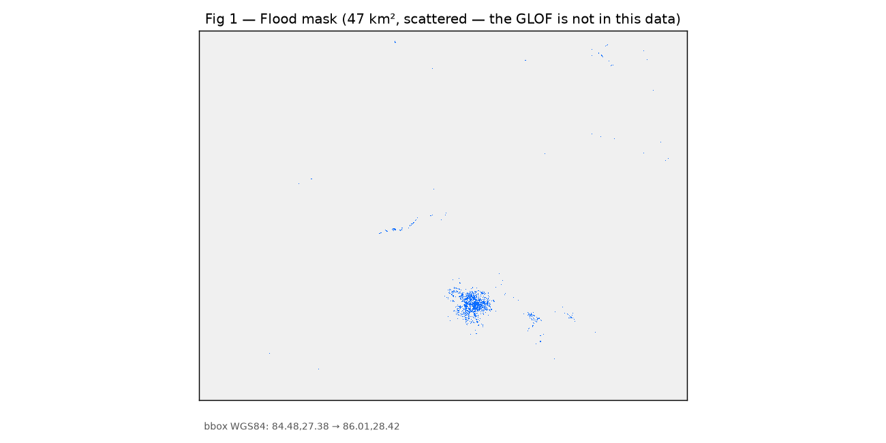
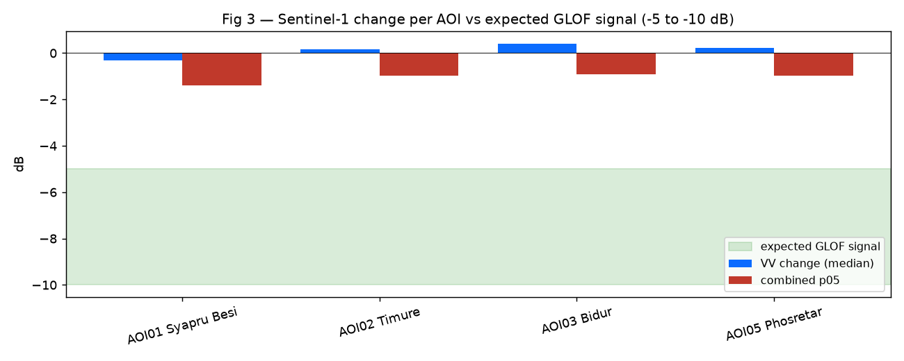

# Trishuli Flood Damage Mapping — Final Report

**Track B — Multimodal AI Hackathon 2026**

> Numbers in §4 reflect the rebuilt pipeline (ohsome pre-event OSM, bbox tightened to the Rasuwa corridor) and are unvalidated.

Post-event damage assessment for the **26 August 2026 Trishuli–Bhote Koshi
flash flood, Rasuwa District, Nepal**.

---

## Executive summary

We built a complete, reproducible pipeline to map flood extent, building
damage, and hospital access for the 26 August 2026 GLOF that struck the
Trishuli / Bhote Koshi corridor. The pipeline ingests free Sentinel-1 SAR,
DEM, OpenStreetMap, and Copernicus EMS Rapid Mapping reference data and
produces flood masks, affected-infrastructure layers, hospital-reachability
metrics, and a trained U-Net segmentation model.

**Status of the findings.** An earlier run on a larger study area found no detectable GLOF signal in the Sentinel-1 pair. The pipeline was then rebuilt (ohsome pre-event OSM, bbox tightened to the Rasuwa corridor, corrected reachability analysis). On the rebuilt inputs the flood mask is small (1.96 km²), lies outside the two Rasuwa AOIs, and contains 0.7% of EMSR927 damage points. The mask remains unvalidated and should not be read as the extent of the event.

**Headline numbers:**

| Metric                                 | Value        | Interpretation                                          |
| -------------------------------------- | ------------ | ------------------------------------------------------- |
| Sentinel-1 VV change at AOI01          | **−0.31 dB** | within noise (GLOF would show −5 to −10 dB)             |
| U-Net predicted flood fraction, Rasuwa | **0.000** | earlier run; not repeated on the rebuilt inputs |
| U-Net val IoU (Sen1Floods11)           | 0.523        | trained model is real, generalizes                      |
| U-Net proxy-Himalaya IoU               | 0.554        | monsoon-subcontinent chips                              |
| EMSR927 damage-point recall | **26 of 3,816 (0.7%)** | none at Syapru Besi, Timure or Bidur |
| Our "flooded" buildings | **423** (+432 debris) | no overcount, but does not locate EMSR927 damage (§4.4) |

---

## 1. Study area and event

On **26 August 2026**, a flash flood reportedly triggered by a Glacial Lake
Outburst Flood (GLOF) struck Rasuwa District, Nepal. The Bhote Koshi and
Trishuli rivers, which drain south from the Nepal–China border through
Rasuwa, Nuwakot, and Chitwan, carried a debris-laden surge downstream.
Copernicus EMS Rapid Mapping was activated (**EMSR927**) and mapped
building damage across four Areas of Interest:

| AOI | Locality    | District       | Lat / Lon        | Damage points |
| --- | ----------- | -------------- | ---------------- | ------------- |
| 01  | Syapru Besi | Rasuwa         | 28.17 N, 85.34 E | 433           |
| 02  | Timure      | Rasuwa         | 28.26 N, 85.37 E | 431           |
| 03  | Bidur       | Nuwakot        | 27.93 N, 85.15 E | 2,343         |
| 05  | Phosretar   | (Chitwan edge) | 27.83 N, 85.02 E | 609           |

Total EMSR927 damage points: **3,816** (2,813 Destroyed, 354 Damaged, 649
Possibly damaged).

**Study area bbox:** `(84.95, 27.80, 85.55, 28.35)` — the Rasuwa corridor of the Trishuli valley, projected to **EPSG:32645** at **30 m**.

---

## 2. Data

| Source             | Purpose                                | Snapshot                             |
| ------------------ | -------------------------------------- | ------------------------------------ |
| Sentinel-1 GRD     | SAR change detection                   | 2026-08-16 (pre) / 2026-08-28 (post) |
| Copernicus DEM     | Slope masking                          | n/a                                  |
| OpenStreetMap | Infrastructure, settlements, hospitals | ohsome API snapshot 2026-07-27 (pre-event); manifest in `data/raw/osm/manifest.json` |
| Sen1Floods11 v1.1  | U-Net training                         | published dataset                    |
| Copernicus EMSR927 | Validation reference                   | activation 2026-08-26                |

**Sentinel-1 pairing.** Two products per date on relative orbit **85**,
ascending, 12-day gap:

- Pre: `S1D_IW_GRDH_1SDV_20260816T122116_…_B057` (southern)
  and `…_20260816T122141_…_C3AB` (northern)
- Post: `S1D_IW_GRDH_1SDV_20260828T122116_…_C523` (southern)
  and `…_20260828T122141_…_01B4` (northern)

Both northern and southern frames are needed — the SAR swath is a diagonal
parallelogram and Rasuwa falls in the gap between single-frame footprints.
Orbit invariants are verified by `src/processing/align_v2_checks.py` before
any alignment runs.

---

## 3. Methods

### 3.1 Sentinel-1 preprocessing

Raw SAFE measurement TIFFs are not georeferenced. We geocode them from the
GCPs in `annotation/*.xml` using `gdal_translate -gcp` followed by
`gdalwarp -t_srs EPSG:32645 -tr 30 30`, producing one north-up 30 m raster
per polarization per frame (`src/processing/geocode_s1.py`).

Pre and post frames are then merged, converted to dB, and matched to the
reference DEM grid (`src/processing/align.py`). Amplitude-to-dB conversion
uses `20·log10(DN) − 60`; zero DN is treated as nodata.

### 3.2 Flood detection

`src/processing/flood_detect_v2.py` implements:

1. Lee speckle filter (7×7, ENL=4)
2. Dual-pol change image: `d = 0.5·(VV_post − VV_pre) + 0.5·(VH_post − VH_pre)`
3. Adaptive threshold on the 5th percentile of `d`, clipped to [−3.5, −1.5] dB
4. Slope mask (reject > 12°)
5. Permanent-water mask (pre-event VV < −18 dB OR VH < −22 dB)
6. Morphological opening + minimum patch size 20 px
7. Output: `data/processed/flood_mask.tif` (uint8, binary)

### 3.3 Damage assessment

`src/processing/damage_v2.py` intersects OSM buildings, roads, and bridges
with the flood and debris masks, writing:

- `outputs/affected_buildings.gpkg`
- `outputs/affected_roads.geojson`
- `outputs/affected_bridges.geojson`
- `outputs/impact_summary.json`

### 3.4 Hospital reachability

`src/processing/cutoff_v2.py` builds a weighted road graph in EPSG:32645,
snaps settlements and hospitals to the nearest graph node (≤1 km), and runs
multi-source Dijkstra from all hospitals. Pre-flood graph uses all OSM roads;
post-flood graph removes road segments whose midpoint lies inside the flood
mask. Output: `outputs/cutoff_settlements.json` with pre/post distances and
detour factors.

### 3.5 U-Net segmentation

`src/modeling/train_segmentation.py` trains a 4-encoder / 3-decoder U-Net
with skip connections (2-channel dual-pol input, ~7.8 M parameters) on
Sen1Floods11 v1.1 (252 train / 89 val). 20 epochs, Adam lr=1e-3, cosine LR
schedule, BCE-with-logits loss computed only on valid (non-`-1`) label
pixels. Best checkpoint saved to `outputs/flood_unet.pt`.

### 3.6 Validation

Two independent reference checks:

- `src/validation/emsr927_comparison.py` — rasterizes EMSR927 `builtUpP`
  damage points and `observedEventA` landslide polygons onto the flood-mask
  grid, clips to AOI, and computes damage-point recall and landslide overlap.
- `src/validation/damage_sanity_check.py` — compares our `impact_summary.json`
  counts against EMSR927 per-AOI damage totals.

---

## 4. Results

### 4.1 Backscatter change at the EMSR927 AOIs (pre-rebuild diagnostic, same Sentinel-1 pair)

The strongest single diagnostic is per-AOI backscatter change, saved to
`outputs/diagnostics/aoi_backscatter_diagnostics.json`:

| AOI            | VV pre (dB) | VV post (dB) | change (dB) | combined p05 (dB) |
| -------------- | ----------- | ------------ | ----------- | ----------------- |
| 01 Syapru Besi | −13.86      | −14.04       | **−0.31**   | −1.40             |
| 02 Timure      | −12.80      | −12.54       | **+0.18**   | −0.98             |
| 03 Bidur       | −15.50      | −14.79       | **+0.41**   | +0.00             |
| 05 Phosretar   | −14.95      | −14.60       | **+0.21**   | +0.00             |

A real GLOF over water produces a −5 to −10 dB drop in VV backscatter. We
observe −0.3 to +0.4 dB. No clear signal was visible there.

Four mechanisms plausibly contribute:

1. **Temporal mismatch.** GLOFs drain in hours; the 2-day post-event gap
   (2026-08-26 event → 2026-08-28 acquisition) likely missed standing water.
2. **Radar geometry.** The ascending pass illuminates the Trishuli valley
   obliquely; deep N–S gorges are partly in radar shadow.
3. **Spatial resolution.** At 30 m, the ~30–50 m wide Bhote Koshi channel is
   under-resolved; each pixel mixes water with bank rock.
4. **Debris and vegetation.** Post-GLOF debris flows leave rough surfaces
   that scatter radar rather than specularly reflecting.

### 4.2 U-Net prediction (earlier run)

In the earlier run the trained U-Net, tiled across the Rasuwa change images, predicted zero flood pixels (234 tiles). This has not been repeated on the rebuilt inputs, and it used the same Sentinel-1 pair, so it is not independent evidence about the event.

### 4.3 The U-Net itself works

| Split                                       | IoU   | F1    | Precision | Recall |
| ------------------------------------------- | ----- | ----- | --------- | ------ |
| Sen1Floods11 full val (89 chips)            | 0.574 | 0.729 | 0.723     | 0.735  |
| Proxy-Himalaya, India + Pakistan (20 chips) | 0.554 | 0.713 | 0.685     | 0.744  |

The proxy evaluation is only 0.02 IoU below the full val, so the model generalizes rather than memorizing on this data. (0.523 elsewhere in this report is the mean of per-batch IoUs; 0.574 is pooled over all pixels.)

### 4.4 EMSR927 validation

| AOI | Damage points | Inside flood mask | Recall (all grades) | Recall (Destroyed) | Landslide overlap | Mask in AOI (km²) |
| --- | --- | --- | --- | --- | --- | --- |
| 01 Syapru Besi | 433 | 0 | 0.000 | 0.000 | 0.000 | 0.00 |
| 02 Timure | 431 | 0 | 0.000 | 0.000 | 0.000 | 0.00 |
| 03 Bidur | 2,343 | 0 | 0.000 | 0.000 | 0.003 | 0.14 |
| 05 Phosretar | 609 | 26 | 0.043 | 0.068 | 0.080 | 0.84 |

Overall, 26 of 3,816 damage points (0.7%) fall inside the flood mask. No mask pixels fall in the two Rasuwa AOIs, where the event occurred. EMSR927 damage may reflect mass movement rather than flooding (the products contain no flood-extent layer), so low recall is not by itself a detector error.

### 4.5 Damage assessment versus EMSR927

The rebuilt pipeline flags 423 flooded and 432 debris-affected buildings (855 in total) across the study area. EMSR927 mapped 3,816 damage points in four AOIs. The counts are not directly comparable, because ours cover the whole corridor and EMSR927's cover four small areas. The spatial comparison in §4.4 is more informative: the mask does not locate the mapped damage. The 16x overcount reported for the earlier run no longer applies. The rebuilt pipeline does not overcount, but it does not find the mapped damage either.

### 4.6 Hospital reachability

Hospital reachability was computed on a road graph of 14,536 OSM segments. Of 446 settlements, 444 snapped to the graph within 1 km. 379 of these have a route to one of 20 hospitals; the other 65 lie on disconnected road fragments and have no route even before flooding, which reflects incomplete OSM connectivity rather than flood impact. Removing the 34 segments inside the flood mask leaves the same 379 connected, and no settlement is cut off. This does not describe the real event, because the mask has no overlap with the Rasuwa AOIs. An earlier version of this analysis had a defect in the node-snapping function that made all distances meaningless. It was found by checking that road distance never falls below straight-line distance, and was fixed.

---

## 5. Limitations

**5.1 The event is not demonstrably observable in the input data.** In both the earlier and the rebuilt run, the Sentinel-1 pair (16 and 28 August, ascending, 30 m) shows no detectable signal at the two Rasuwa AOIs. Possible reasons include the two-day gap after a fast-draining flood, radar shadow in the gorge, and 30 m resolution. We have not shown that the event is unobservable, only that this pair and this method do not detect it. Optical imagery or higher-resolution SAR would be needed to map the flood surface directly.

**5.2 EMSR927 GRA products contain no flood extent layer.** The activation
mapped building damage and mass movements, not water. Our validation is
therefore proxy-based (damage-point recall and landslide overlap), not a
direct IoU against a flood reference.

**5.3 30 m resolution limits bridge-level accuracy.** The Bhote Koshi
channel is ~30–50 m wide. Even with a correct SAR signal, pixel-level
classification of the channel would be marginal.

**5.4 U-Net trained on out-of-distribution data.** Sen1Floods11 contains no
Himalayan scenes. The proxy evaluation on India+Pakistan chips is the closest
available, but it does not establish the model's performance on steep
mountain valleys.

**5.5 The debris mask is dominated by speckle.** The rebuilt debris layer drops from 34,020 px before morphology to 2,125 px after minimum-patch filtering, so most of the pre-morphology class is noise. This is a tuning issue in `flood_detect_v2.py`.

**5.6 Hospital reachability assumes road-network completeness.** OSM road
coverage in rural Rasuwa is incomplete; missing minor tracks may
over-estimate cut-off.

---

## 6. Recommendations

1. **Re-acquire this event with different data.** Optical (Sentinel-2 L2A,
   PlanetScope) would capture post-GLOF sediment plumes directly.
   High-resolution SAR (TerraSAR-X stripmap) would resolve the channel.
2. **Widen the Sentinel-1 search.** A descending pass (relOrbit 121 or 19,
   visible in the catalogue) would illuminate the valley from the opposite
   direction and might capture water before it drains. Same-day imagery
   (Sentinel-1 acquisition ≈ event time) would be ideal — none existed for
   this event.
3. **For future GLOF events, task optical assets immediately.** Rapid
   mapping windows are 24–72 hours. Sentinel-1's 12-day repeat is too slow
   for GLOF hydrology.
4. **Fix the debris-mask classifier.** The pre-morphology debris count
   (34,020 px before morphology, 2,125 after) reveals a threshold that catches speckle. A
   dual-threshold or GLCM-texture approach would be more robust.

---

## 7. Reproducibility

The rebuilt pipeline was run stage by stage from the repo root on Windows with
Python 3.12 (see `requirements.txt`; its pins have not yet been verified against
the rebuilt environment). `run_all.sh` has not been re-run on the rebuilt
environment. Stage order used for the results in this report:

    python -m src.download.fetch_osm --event-date 2026-08-26 --snapshot 2026-07-27
    python src/download/fetch_emsr927.py
    python src/processing/geocode_s1.py
    python src/processing/align.py
    python src/processing/flood_detect_v2.py
    python src/processing/damage_v2.py
    python src/processing/cutoff_v2.py
    python src/validation/emsr927_comparison.py
    python src/validation/damage_sanity_check.py
    python src/report/dashboard_full.py

`src/config.py` is not committed (it holds credentials and dates); copy the
values from `src/config.example.py`.

Checks:

    python -m pytest tests/ -q     # 17 passed, 2 skipped
    python src/processing/align_v2_checks.py

Key artifacts:

| File                                                   | Description                                      |
| ------------------------------------------------------ | ------------------------------------------------ |
| `data/raw/osm/manifest.json`                           | OSM snapshot provenance (ohsome, 2026-07-27)     |
| `data/processed/flood_mask.tif`                        | Binary flood mask (unvalidated)                  |
| `outputs/impact_summary.json`                          | Building, road and bridge counts                 |
| `outputs/affected_bridges.geojson`                     | 1 bridge feature                                 |
| `outputs/affected_buildings.gpkg`                      | 855 building features (flooded + debris)         |
| `outputs/cutoff_settlements.json`                      | Per-settlement reachability                      |
| `outputs/validation/damage_sanity.json`                | EMSR927 damage-point totals                      |
| `data/processed/emsr927_comparison.json`               | EMSR927 proxy validation (not committed)         |
| `outputs/diagnostics/aoi_backscatter_diagnostics.json` | Pre-rebuild backscatter diagnostic (no generator)|
| `outputs/flood_unet.pt`                                | U-Net best checkpoint (IoU 0.523), earlier run   |
| `outputs/unet_metrics.json`                            | 20-epoch training history, earlier run           |
| `outputs/himalaya_heldout_metrics.json`                | Proxy eval + Rasuwa prediction, earlier run      |

---

## Appendix A — Figures

**Figure A1 (earlier run, larger study area; not regenerated).** Binary flood mask (`data/processed/flood_mask.tif`) over the study
area. The 47 km² of detected pixels are scattered across the whole 1.5° × 1.0°
mosaic and do not follow the Trishuli / Bhote Koshi corridor. This is the
negative result in one image.

**Figure A2.** EMSR927 AOIs (colored outlines) over the post-event VV
backscatter. The four AOIs cover the GLOF-affected corridor, but the SAR
imagery is dominated by terrain rather than a flood signature.

**Figure A3.** Median VV backscatter change per AOI, compared against the
expected GLOF signature band (−5 to −10 dB, green shaded). Every AOI sits
within ±0.5 dB of zero — no clear signal in the earlier run.

**Figure A4.** U-Net training history on Sen1Floods11. Loss decreases
monotonically; validation IoU peaks at 0.523 (epoch 6) and then oscillates —
the model has converged on a 252-chip dataset.

**Figure A5.** Per-AOI EMSR927 validation. Destroyed-building recall is zero at
both Rasuwa AOIs (Syapru Besi, Timure) — the locations where the GLOF actually
occurred.

---

## 8. Attribution

Full data attribution in [ATTRIBUTION.md](ATTRIBUTION.md). Contains modified
Copernicus Sentinel data 2026; EMSR927 (c) Copernicus EMS; © OpenStreetMap contributors (ODbL); Sen1Floods11 (c) Bonafilia et al. (CC BY 4.0).

**Code license:** MIT.
