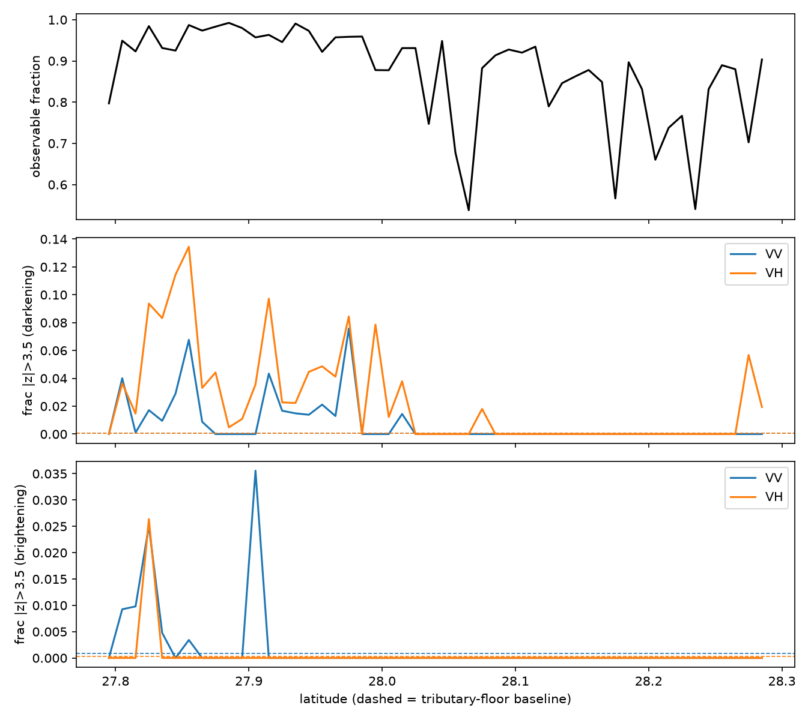
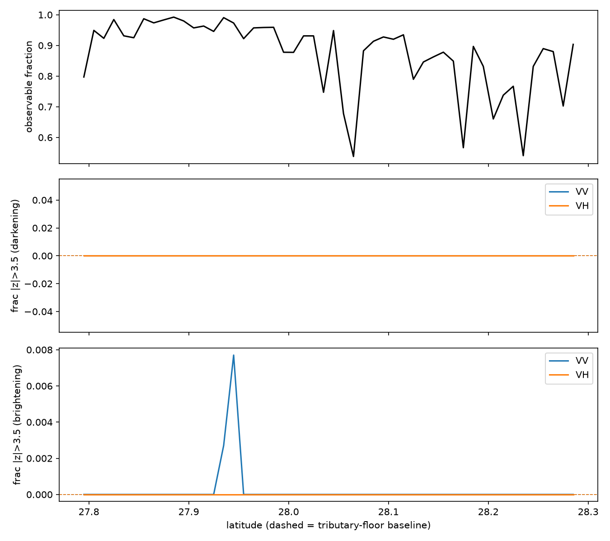
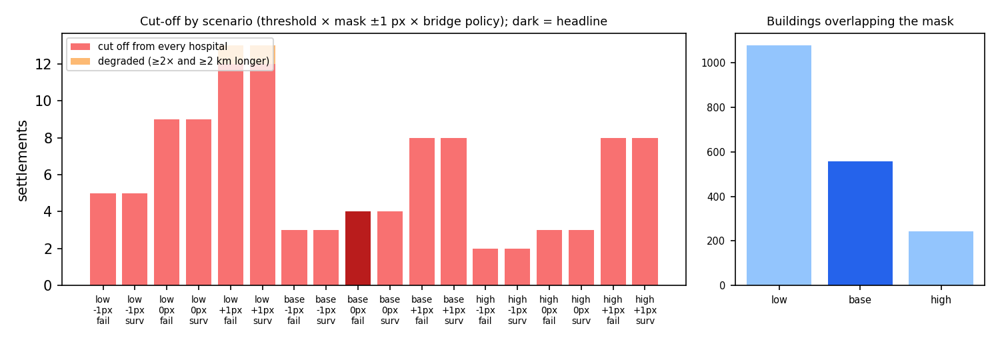
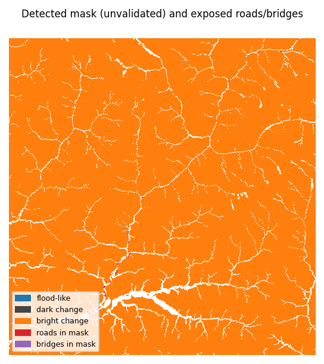

# Trishuli / Bhote Koshi flood, 2026-08-26: change detection, exposure and road access from open satellite data

*Multimodal AI Hackathon 2026, FloodDamage from Space. Educational prototype, not an operational product. Generated 2026-10-12 from commit `bf89060`; every number below is read from the pipeline's output files.*

**Status.** Detector status **change_detected** on Sentinel-1 track asc85. The product is surface change on the valley floor and exposure to it, **not a validated flood extent**. Flood-like change (0.31 km² of water-like backscatter change) and surface change (2.29 km² dark, 0.54 km² bright) are each separable from all four pre-event nulls. An independent single-date water model could not separate the event from pre-event dates, and Sentinel-2 does not confirm open water.

## 1. Approach and data

One pipeline (`python -m src.run`) runs from raw data. The validated route downloads Sentinel-1 GRD from the Copernicus Data Space Ecosystem; scenes are calibrated and terrain-corrected with ESA SNAP (sigma0), gridded to 30 m (10 m for the AI model), and compared with four pre-event reference dates on the same track; the HAND valley floor and a radar layover/shadow mask come from the Copernicus DEM; detected change is overlaid on pre-event OpenStreetMap buildings, roads and bridges; road paths from each settlement to the nearest hospital are recomputed with blocked segments removed; a dashboard and a one-page situation report are built from the outputs.

| Data | Role | Dates |
|---|---|---|
| Sentinel-1 GRD, relative orbit 85 ascending | input | references 2026-08-16, 2026-08-04, 2026-07-23, 2026-07-11; post 2026-08-28 |
| Sentinel-2 L2A | input (gated; excluded if it fails its gate) | post-event scenes from 2026-08-27 |
| Copernicus DEM GLO-30 | input (HAND, radar geometry, flow path) | n/a |
| OpenStreetMap via ohsome | input, **pre-event snapshot** | 2026-07-27 |
| Sen1Floods11 v1.1 hand labels | AI training | published splits |
| Copernicus EMS EMSR927 | **checking only**, after thresholds were frozen | activation 2026-08-26 |

Rules enforced in code: the OSM snapshot must predate the flood; detector thresholds come from pre-event null runs, never from EMS; EMS is read only by `src/validation/`; unobservable ground is UNKNOWN, never clear; bridges are *exposed*, never declared failed; settlements without a pre-flood road route are *not assessed*, never counted as cut off.

## 2. Detection method and evidence

VH robust-z change of the post scene against the four references, restricted to the HAND ≤ 30 m valley floor (200 km², 90% usable after the radar mask). Thresholds 4 / 2.5 are the smallest values whose worst false-alarm fraction over the null runs is ≤ 1e-3 (calibrated against pre-event nulls, null false-alarm max 0.035%; minimum detectable area ≈ 0.21 km²). Classes: flood-like (dark and below open-water dB), dark change, bright change. Headline areas: 0.31 km² flood-like, 2.29 km² dark, 0.54 km² bright.

| Band | Main floor decrease px | Tributary floor | Event excess [95% CI] | Placebo excess [95% CI] |
|---|---|---|---|---|
| VV | 1.9% | 0.1% | 1.8% [0.9%, 2.9%] | 0.0% [0.0%, 0.0%] |
| VH | 4.5% | 0.1% | 4.4% [2.7%, 6.5%] | 0.0% [0.0%, 0.0%] |

The step-3 criteria were written after the first event run, so this test is exploratory.

**Class-level nulls** (separable only if event area > 3x the largest null area (nulls ungated, leave-one-out)):

| Class | Event km² | Largest null km² | Ratio | Separable |
|---|---|---|---|---|
| flood_water | 0.306 | 0.014 | 21.2 | yes |
| surface_dark | 2.294 | 0.040 | 57.9 | yes |
| surface_bright | 0.542 | 0.092 | 5.9 | yes |

**Flood-like change (0.31 km² of water-like backscatter change) and surface change (2.29 km² dark, 0.54 km² bright) are each separable from all four pre-event nulls. An independent single-date water model could not separate the event from pre-event dates, and Sentinel-2 does not confirm open water.**

 

## 3. Impact and cut-off

| Item | Headline | Scenario range |
|---|---|---|
| Buildings overlapping the mask | 556 (6 flood-like, 550 other change) of 189,503 | 244–1,078 |
| Buildings with unknown status (outside the observed floor) | 174,132 (92%) | n/a |
| Motorable road in mask | 11.8 km | 6.4–22.0 km |
| Bridges exposed (not failed) | 20 of 385 | 12–30 |
| Settlements cut off / degraded | 4 / 0 | 2–12 / 0–1 |

4 of 446 settlements are cut off from every hospital (range 2–12), 0 degraded (range 0–1); 141 have no pre-flood road route and are not assessed. Range = 3 thresholds × mask ±1 px × bridges fail/survive; 18 of 20 hospitals snap to the road network. There is no cut-off ground truth.

## 4. AI component

ResNet34 U-Net (segmentation-models-pytorch), Sentinel-1 VV+VH input, trained on Sen1Floods11 hand labels; threshold 0.4 chosen on validation only. The seed-0 model is the shipped model; seeds 1 and 2 measure training noise.

| Split | Chips | Shipped IoU [95% chip CI] | Mean ± sd over 3 seeds |
|---|---|---|---|
| Sen1Floods11 valid (selection) | 89 | 0.672 [0.59–0.74] | 0.672 ± 0.005 |
| Sen1Floods11 test (training events) | 90 | 0.682 [0.57–0.77] | 0.682 ± 0.002 |
| Bolivia (unseen region) | 15 | 0.680 [0.46–0.80] | 0.702 ± 0.020 |

 **Himalayan evidence: no labelled Himalayan test yet.** The pre-registered rule (≥70% clear Sentinel-2) kept 0 of 20 chips on 27 Aug and on 12 Aug; an algorithmic scan for clear windows by stratum (never by prediction) found 4 windows over both dates (27/08: main 1/8, trib 0/8, hill 1/4; 12/08: main 0/8, trib 0/8, hill 2/4; 20 sought per date), fewer than the 8 required. The written amendment (docs/validation_log.md, before any labelling) keeps all 20 chips and labels clear pixels only; until those labels exist the Himalayan evidence is qualitative: six example panels (first six chips in file order, `outputs/figures/himalaya_example_panels.png`), Bolivia (not Himalayan) and the corridor null below. Bolivia (the only unseen-region test, 15 chips): shipped IoU 0.680, chip CI 0.46–0.80. Corridor null test (prediction-only): excess 0.009 vs largest leave-one-out null 0.008: **not separable from the nulls**. The model detects **open water only**; no allowed dataset labels debris, so debris comes from the change detector.

## 5. Validation against Copernicus EMS EMSR927 (check only)

The local EMSR927 products are grading maps: `observedEventA` is **landslide** polygons and there is **no flood-extent layer**, so scores are "detected change vs EMS landslide polygons" and the flood class cannot be validated against EMS. Domain: AOI minus notAnalysedA, restricted to pixels the detector observed. Chance for damage points: the mask's own blobs relocated at random (100 draws); CI: 1 km block bootstrap.

| AOI | Precision | Recall | IoU | EMS damage points within 30 m [95% CI] vs chance |
|---|---|---|---|---|
| AOI01 Syapru Besi | n/a | 0.000 | 0.000 | 0.000 [0.00–0.00] n/a |
| AOI02 Timure | n/a | 0.000 | 0.000 | 0.000 [0.00–0.00] n/a |
| AOI03 Bidur (hold-out) | 0.928 | 0.174 | 0.172 | 0.345 [0.17–0.49] indistinguishable from chance |
| AOI05 Phosretar | 0.990 | 0.245 | 0.244 | 0.118 [0.04–0.26] indistinguishable from chance |
| **Pooled non-hold-out** | 0.990 | 0.185 | 0.185 | |
| **Pooled hold-out** | 0.928 | 0.174 | 0.172 | |

Syapru Besi: n/a; Timure: n/a; Bidur: indistinguishable from chance; Phosretar: indistinguishable from chance. Association with damage points is not attribution to flooding; every EMS scoring is listed in `docs/validation_log.md`.

## 6. Robustness: route check and dry runs

**Route equivalence (case study, rule written before the run): FAIL.** Planetary Computer RTC gamma0 vs SNAP sigma0, same scenes and grid: flagged 3.53 vs 3.14 km² (pass, ±50%), pixel IoU 0.36 (pass, ≥ 0.3), but bright change is not separable from the nulls on PC while it is separable on SNAP, and flood-like change falls from 0.31 to 0.05 km² (the fixed water gates were set for sigma0; gamma0 is brighter). The PC route, Sentinel-1 RTC (Planetary Computer sentinel-1-rtc, third-party processed from GRD), is therefore **cross-check only**.

Dry runs on unseen areas (PC route, `--profile fast`, Kaggle CPU; cross-check only):

| Run | Status | t_hi | Null FAR max | Alpha met | Min. detectable area | Buildings unknown | Run time |
|---|---|---|---|---|---|---|---|
| Negative control (Trishuli box, event 2026-08-01) | no_significant_change | 5 | 0.03% | yes | 0.17 km² | 92% | 14.0 min |
| Terai (lowland box, event 2026-08-26) | no_significant_change | 6 | 0.20% | **no** | 17.37 km² | 3% | 12.6 min |

Minimum detectable area = gate threshold × assessed floor. The case study's 3.14 km² is about 15× its limit of 0.21 km²; in the Terai box no threshold met the 0.1% target and the limit is 17 km², so a same-size event there would be undetectable. One negative-control reference (2026-06-22) is Sentinel-1A while the others are Sentinel-1D on the same relative orbit, which is why it sits 7 days off the 12-day grid; the stack checks now warn on mixed platforms and on acquisition times > 10 min apart.

## 7. Limitations

- Single Sentinel-1 track (asc85), one post scene 2 days after the event; a flash flood in a gorge may have drained.
- Valley floor only: 92% of OSM buildings and the hillside roads are outside it and UNKNOWN, not clear.
- Sentinel-2: 12% of the floor has clear post-event coverage; status null_not_calibrated, so S2 is excluded from the fused product.
- No cause attribution: flood-like, dark and bright are surface-change classes; bridges are exposed, never known failed.
- OSM currency: snapshot 2026-07-27; rural Rasuwa is under-mapped (141 settlements have no pre-flood route), so cut-off can be overstated and damage undercounted.
- No cut-off ground truth exists; the scenario range is the uncertainty we can quantify.
- Flood-like change (0.31 km² of water-like backscatter change) and surface change (2.29 km² dark, 0.54 km² bright) are each separable from all four pre-event nulls. An independent single-date water model could not separate the event from pre-event dates, and Sentinel-2 does not confirm open water.
- AI vs Sentinel-2 cannot arbitrate (appendix only): S2 MNDWI agreement on clear floor pixels is a pseudo-reference (post IoU 0.06 (P 0.51, R 0.07); pre IoU 0.03 (P 0.49, R 0.03)); precision is about 0.5 on both the pre- and post-event dates, so agreement that does not change with the event cannot arbitrate anything.

## 8. Attribution and citations

"Contains modified Copernicus Sentinel data 2026." "Produced using Copernicus WorldDEM-30 © DLR e.V. 2010–2014 and © Airbus Defence and Space GmbH 2014–2018 provided under COPERNICUS by the European Union and ESA; all rights reserved." "© OpenStreetMap contributors." Copernicus EMS credit: "European Union, Copernicus Emergency Management Service data" (EMSR927, checking only). EMSR927 GRA products held locally (checked 2026-10-11) contain landslide polygons and damage points, no flood-extent layer. Educational prototype, not an operational tool. Sen1Floods11: Bonafilia, D., Tellman, B., Anderson, T., Issenberg, E. (2020), CVPR Workshops (CC BY 4.0). Flood-path bonus: D8 path 89.6 km, 20 settlements on the HAND corridor (geometry only, no hydraulics).